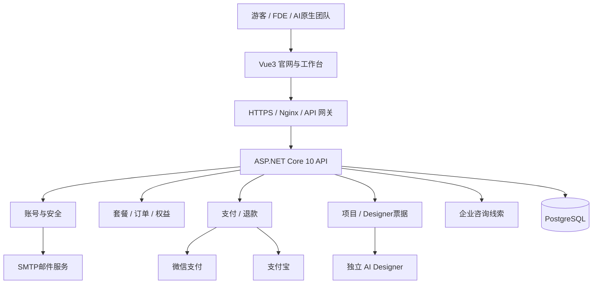

# Vizora AI V4.2 概要设计说明书

版本：V1.0（依据 V4.2 源码梳理） · 日期：2026-10-20

## 1. 设计目标与范围

产品定位：面向 FDE 和 AI 原生组织的可视化应用快速创建与交付 SaaS。品牌主张：“你有一个想法，Vizora AI 给你一个可视化应用。”

**现有 V4.2 的实际边界**：商业官网、用户认证与邮箱验证、项目创建/删除、外部 AI Designer SSO 入口、人民币套餐订单、微信 Native/支付宝电脑网站支付接口、订单查询、退款管理接口、销售线索保存。V4.2 的 dashboards 是项目记录，并非完整通用 Visual App Runtime；设计器内部生成与运行逻辑仍为外部集成。

**本设计的内容**：信息架构、业务架构、部署架构、模块职责、关键流程、数据结构、界面原型与生产验收。页面原型中的后台运营、组织协作、应用运行发布、发票等如未在源码中实现，均标注“规划”。

## 2. 用户角色与业务边界

| 角色 | 目标 | 主要能力 | 当前状态 |
|---|---|---|---|
| 游客 | 理解产品、试用、购买决策 | 官网、模板、套餐、咨询 | 已有页面 |
| 个人用户 | 注册、项目管理、购买 | 邮箱验证、登录、创建项目、查看订单 | 基础实现 |
| FDE 工程师 | 快速交付可视化应用 | 项目创建、跳转独立 Designer | 外部集成待联调 |
| 企业采购者 | 企业授权咨询 | 咨询表单、合同和报价流程 | 线索表已实现，CRM流程规划 |
| 平台管理员 | 订单退款、线索处理 | API 查询、退款核对 | API 已有；管理 UI 规划 |
| 财务运营 | 支付对账、发票 | 查询支付退款状态、财务复核 | 部分 API；全流程规划 |

## 3. 全站信息架构

**公开官网**：首页 `/` → 产品能力 `/features` → 应用场景 `/solutions` → 模板市场 `/templates` → 资源中心 `/resources` → 定价 `/pricing` → 联系我们 `/contact` → 条款 `/terms`、隐私 `/privacy`。

**账号安全**：登录 `/login`、注册 `/register`、验证邮箱 `/verify-email`、重发验证 `/resend-verification`、忘记密码 `/forgot-password`、重置密码 `/reset-password`。

**用户业务**：工作台 `/workspace`（我的项目、创建、Designer 入口）→ 会员账单 `/billing`（会员和订单）。

**拟扩展的完整商业运营前台**：支付收银台、订单详情、退款申请、发票申请、组织与成员、运行发布中心、集成密钥、账号安全设置。

**拟扩展管理后台**：管理仪表盘、用户与会员、订单与退款、财务对账、销售线索、套餐配置、系统审计。

## 4. 总体技术架构

首发采用模块化单体 API，未来可按负载拆出支付对账、应用运行服务与 AI Agent。数据库不向公网暴露；生产密钥置于受控密钥管理系统。

## 5. 核心模块概要

| 模块 | 已有实现 | 需补充的生产能力 |
|---|---|---|
| Identity | 注册/登录、邮箱验证、找回密码、JWT token_version、登出所有会话 | 防爆破/CAPTCHA、注销导出、审计、SMTP联调 |
| Membership | plans/memberships、订单级 grants | 权益续期重算、并发/升级降级、组织席位 |
| Orders | 创建/查询、支付结果查询 | 过期关闭、重复下单、全渠道补单、定期对账 |
| Payments | 微信Native与支付宝网页支付、回调校验代码 | 商户证书/签名联调、真实交易、支付异常工单 |
| Refunds | 管理员发起与查询结案、单Grant撤销 | 叠加权益重算、部分退款、自动/人工核对工作台 |
| Designer | 创建项目、2分钟一次性 SSO ticket | SSO完整联调、项目组织权限、版本与回调 |
| Sales Leads | 表单提交、管理查询 API | 运营分配、跟进、合规存留删除 |
| Operations | 健康接口、部署脚本 | 安全监控、备份恢复、灰度与回滚 |

## 6. 关键业务流程

### 6.1 注册与账号安全

用户提交邮箱与高强度密码 → API 校验和账号创建 → 生成单次验证令牌（服务端仅存哈希）→ 发送30分钟有效验证邮件 → 用户点击链接 → 激活邮箱 → 登录 → 生成 JWT。重置密码成功后 `token_version+1` 使旧会话失效。未验证邮箱禁止登录。

### 6.2 购买与权益开通

选择套餐 → 创建不可变金额订单（以数据库计划价为准）→ 微信扫码/支付宝跳转 → 支付通知签名校验、商户和金额校验 → 事件去重 → 订单置 `paid` → 记录 `entitlement_grants` → 更新会员权益 → 前端展示订单状态。**不可依赖浏览器返回页发放权益**。

### 6.3 退款与会员权益

管理员核对订单 → 创建退款记录 → 调用商户退款 → `processing` → 商户查询/回调得到最终成功 → 撤销关联 grant；存在叠加支付时生成 `entitlement_review` 供人工复核。生产版必须完成所有叠加组合的重算及对账。

### 6.4 Designer 接入

工作台新建项目 → API 检查项目所有权与配额 → `/api/designer/ticket` 下发2分钟短期一次性 ticket → 打开独立 Designer → Designer 服务端通过 `/api/designer/redeem` 兑换 → 建立自身安全会话 → 编辑与保存（由 Designer 实现）。禁止长期 token 放入 URL。

## 7. 核心数据模型

数据库表：`users`、`account_tokens`、`plans`、`memberships`、`dashboards`、`orders`、`payment_events`、`refunds`、`entitlement_grants`、`entitlement_review`、`ticket_nonces`、`sales_leads`。

关联原则：User 1:N Dashboards；User 1:N Orders；Order 1:0..1 Refund（现有索引限制活跃退款）；Order 1:0..1 EntitlementGrant；User 1:1 Membership。支付事件按 provider+event_key 去重。

建议 V4.3 补充 `organizations`、`members`、`app_versions`、`publications`、`audit_logs`、`invoices`、`reconciliation_batches`，但不应将其写成 V4.2 已有表。

## 8. UI 设计规范

- 视觉：官网深蓝 `#061328`，品牌蓝 `#246BFF`，高亮青 `#48C7FF`；后台采用深蓝边栏、浅色内容面板提升操作效率。
- 版式：1440px 桌面基线，内容宽度 1200px；首页采用长页分区，区块上下间距 84–112px；移动端堆叠展示。
- 官网首屏：品牌主张、输入想法、主要 CTA、真实产品预览；行业场景、优势、套餐、FAQ 分段呈现，避免首屏堆叠。
- 状态：明确 loading / empty / error / success / expired / pending，不只设计成功页面。
- 可访问性：键盘可操作、显著焦点、表单错误说明、文字对比和响应式适配。

## 9. 页面原型列表与交互

| 编号 | 页面 | 关键交互 | V4.2 对应 |
|---|---|---|---|
| P01 | 官网首页 | 输入想法、CTA、导航、场景跳转 | 已有 |
| P02 | 产品能力 | 能力分类、Designer 流程 | 已有 |
| P03 | 应用场景 | FDE/AI原生团队切换 | 已有 |
| P04 | 模板市场 | 分类、搜索、模板详情 | 已有基础 |
| P05 | 价格套餐 | 月年切换、产品权益、购买 | 已有基础 |
| P06 | 企业咨询 | 联系表单与同意项 | 已有 |
| P07 | 注册登录 | 验证与错误提示 | 已有 |
| P08 | 账号恢复 | 邮箱验证、重发、重置 | 已有 |
| P09 | 我的工作台 | 创建、删除、打开 Designer | 已有 |
| P10 | 会员订单 | 当前权益、订单列表 | 已有基础 |
| P11 | 管理后台 | 订单、退款复核、销售线索 | **规划 UI**；部分 API 已有 |
| P12 | 应用发布中心 | 版本、环境、分享、访问权限 | **规划** |

可交互 HTML 原型文件 `Vizora_AI_V4.2_界面原型.html` 用于查看主要页面布局和状态。所有原型数据和支付动作均为演示，不触发真实商户接口。

## 10. 关键非功能设计

- 安全：全站 HTTPS、JWT 版本校验、密码哈希、速率限制、商户回调验签、审计日志、最小权限和跨租户隔离。
- 可靠性：订单和权益事务一致性、幂等通知、失败重试、定期对账、备份与恢复演练。
- 监控：登录异常、商户回调失败、订单待支付积压、退款异常、邮件失败、Designer SSO 兑换失败。
- 性能：站点静态资源缓存与压缩，API 与数据库限流；并发目标必须由实际压测确定。
- 合规：ICP/业务资质、用户协议、隐私、个人信息处理、发票、退款及消费者保护规则应经真实运营主体审查。

## 11. 生产上线阻断项与验收

P0：Vue 与 .NET 10 Release 编译；真实 SMTP；微信/支付宝真实小额交易与对账；退款权益重算；注册防滥用；Designer SSO 端到端；迁移/备份恢复；HTTPS、日志脱敏、安全测试。

P1：完整运营后台、发票流程、企业组织、应用发布管理与计量；在此之前不得把相关 UI 的演示能力标为已上线。

**现状声明**：源码记录的静态检查通过，不等于真实编译及资金交易联调通过。本设计不是“已达到生产验收”的证明。

## 12. 建议后续工程包

V4.3 优先：①构建与 CI 自动化；②账号/支付端到端测试；③完整后台操作 UI；④权益状态机和定期对账；⑤正式 Designer SSO 合同。V4.4 再建设组织、多应用、运行发布、应用版本与计量体系。
